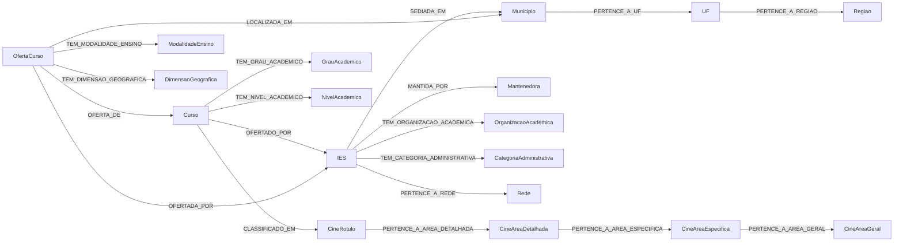

# Modelo do LPG — Censo da Educação Superior 2024

## Visão geral

O grafo representa os microdados do **Censo da Educação Superior 2024** (INEP/MEC) como um *Labeled Property Graph* (LPG), com um nó central de **oferta de curso** e nós de dimensão para instituição, curso, geografia e classificações.

- **Ano:** 2024
- **Ofertas de curso:** 720.349
- **Cursos distintos:** 46.150
- **IES:** 2.561
- **Mantenedoras:** 1.755
- **Municípios:** 3.551
- **UFs:** 27
- **Regiões:** 5
- **Nós:** 774.915
- **Arestas:** 3.791.431

A granularidade da oferta é dada por:

```text
CO_IES + CO_CURSO + CO_MUNICIPIO + TP_DIMENSAO + TP_MODALIDADE_ENSINO
```

Essa combinação é única nas 720.349 linhas do arquivo de cursos de 2024.

## Diagrama



## Nós

| Label | Chave | Qtd | Origem |
|---|---|---:|---|
| `Regiao` | `CO_REGIAO` | 5 | Cursos + IES |
| `UF` | `CO_UF` | 27 | Cursos + IES |
| `Municipio` | `CO_MUNICIPIO` | 3.551 | Cursos + IES |
| `IES` | `CO_IES` | 2.561 | IES |
| `Mantenedora` | `CO_MANTENEDORA` | 1.755 | IES |
| `Curso` | `CO_IES + CO_CURSO` | 46.150 | Cursos |
| `OfertaCurso` | chave composta da oferta | 720.349 | Cursos |
| `CineRotulo` | `CO_CINE_ROTULO` | 353 | Cursos |
| `CineAreaDetalhada` | `CO_CINE_AREA_DETALHADA` | 89 | Cursos |
| `CineAreaEspecifica` | `CO_CINE_AREA_ESPECIFICA` | 39 | Cursos |
| `CineAreaGeral` | `CO_CINE_AREA_GERAL` | 11 | Cursos |
| `GrauAcademico` | `CO_GRAU` (1, 2, 3 e `NA`) | 4 | Cursos |
| `ModalidadeEnsino` | `CO_MODALIDADE_ENSINO` | 2 | Cursos |
| `NivelAcademico` | `CO_NIVEL_ACADEMICO` | 2 | Cursos |
| `OrganizacaoAcademica` | `CO_ORGANIZACAO_ACADEMICA` | 5 | IES |
| `Rede` | `CO_REDE` | 2 | IES |
| `CategoriaAdministrativa` | `CO_CATEGORIA_ADMINISTRATIVA` | 6 | IES |
| `DimensaoGeografica` | `CO_DIMENSAO` | 4 | Cursos |

O código de grau `4` (Bacharelado e Licenciatura) existe no dicionário, mas não ocorre nos dados de 2024; por isso não há nó correspondente. As categorias administrativas `6`, `8` e `9` também não ocorrem em 2024.

## Arestas

| Tipo | De → Para | Qtd |
|---|---|---:|
| `PERTENCE_A_REGIAO` | UF → Regiao | 27 |
| `PERTENCE_A_UF` | Municipio → UF | 3.551 |
| `SEDIADA_EM` | IES → Municipio | 2.561 |
| `MANTIDA_POR` | IES → Mantenedora | 2.561 |
| `TEM_ORGANIZACAO_ACADEMICA` | IES → OrganizacaoAcademica | 2.561 |
| `TEM_CATEGORIA_ADMINISTRATIVA` | IES → CategoriaAdministrativa | 2.561 |
| `PERTENCE_A_REDE` | IES → Rede | 2.561 |
| `OFERTADO_POR` | Curso → IES | 46.150 |
| `TEM_GRAU_ACADEMICO` | Curso → GrauAcademico | 46.150 |
| `TEM_NIVEL_ACADEMICO` | Curso → NivelAcademico | 46.150 |
| `CLASSIFICADO_EM` | Curso → CineRotulo | 46.150 |
| `OFERTA_DE` | OfertaCurso → Curso | 720.349 |
| `OFERTADA_POR` | OfertaCurso → IES | 720.349 |
| `LOCALIZADA_EM` | OfertaCurso → Municipio | 708.571 |
| `TEM_MODALIDADE_ENSINO` | OfertaCurso → ModalidadeEnsino | 720.349 |
| `TEM_DIMENSAO_GEOGRAFICA` | OfertaCurso → DimensaoGeografica | 720.349 |
| `PERTENCE_A_AREA_DETALHADA` | CineRotulo → CineAreaDetalhada | 353 |
| `PERTENCE_A_AREA_ESPECIFICA` | CineAreaDetalhada → CineAreaEspecifica | 89 |
| `PERTENCE_A_AREA_GERAL` | CineAreaEspecifica → CineAreaGeral | 39 |

## Propriedades

### `OfertaCurso`

- `NU_ANO_CENSO`
- `CO_IES`, `CO_CURSO`, `CO_MUNICIPIO`
- `IN_CAPITAL`
- `TP_DIMENSAO`
- `TP_MODALIDADE_ENSINO`
- As **193 variáveis `QT_*`** do cadastro de cursos, preservadas com os nomes originais.

As variáveis `QT_*` são contagens brutas, sem agregação ou deduplicação. O dicionário completo está em `schema/dicionario_variaveis.csv`.

### `Curso`

- `NU_ANO_CENSO`
- `CO_IES`, `CO_CURSO`, `NO_CURSO`
- `CO_CINE_ROTULO`, `NO_CINE_ROTULO`
- `CO_CINE_AREA_DETALHADA`, `NO_CINE_AREA_DETALHADA`
- `CO_CINE_AREA_ESPECIFICA`, `NO_CINE_AREA_ESPECIFICA`
- `CO_CINE_AREA_GERAL`, `NO_CINE_AREA_GERAL`
- `TP_GRAU_ACADEMICO`, `TP_NIVEL_ACADEMICO`
- `IN_GRATUITO`

### `IES`

Preserva as **84 colunas originais** do cadastro de IES, incluindo:

- identificação (`CO_IES`, `NO_IES`, `SG_IES`);
- endereço e CEP;
- município, UF, região, mesorregião e microrregião da sede;
- organização acadêmica, rede, categoria administrativa e indicadores comunitário/confessional;
- quantidade de técnicos por escolaridade e sexo;
- indicadores de biblioteca e acervo;
- quantidade de docentes por escolaridade, sexo, idade, cor/raça, nacionalidade e deficiência.

### Nós geográficos e de classificação

- `Regiao`: `CO_REGIAO`, `NO_REGIAO`
- `UF`: `CO_UF`, `SG_UF`, `NO_UF`, `CO_REGIAO`
- `Municipio`: `CO_MUNICIPIO`, `NO_MUNICIPIO`, `CO_UF`, `SG_UF`, `IN_CAPITAL`
- `Mantenedora`: `CO_MANTENEDORA`, `NO_MANTENEDORA`
- `CineRotulo`: código, nome e código da área detalhada
- `CineAreaDetalhada`: código, nome e código da área específica
- `CineAreaEspecifica`: código, nome e código da área geral
- `CineAreaGeral`: código e nome
- `GrauAcademico`: `CO_GRAU`, `NO_GRAU`
- `ModalidadeEnsino`: `CO_MODALIDADE_ENSINO`, `NO_MODALIDADE_ENSINO`
- `NivelAcademico`: `CO_NIVEL_ACADEMICO`, `NO_NIVEL_ACADEMICO`
- `OrganizacaoAcademica`: `CO_ORGANIZACAO_ACADEMICA`, `NO_ORGANIZACAO_ACADEMICA`
- `Rede`: `CO_REDE`, `NO_REDE`
- `CategoriaAdministrativa`: `CO_CATEGORIA_ADMINISTRATIVA`, `NO_CATEGORIA_ADMINISTRATIVA`
- `DimensaoGeografica`: `CO_DIMENSAO`, `NO_DIMENSAO`, `ABRANGENCIA`

## Decisões de modelagem

1. **Nó central `OfertaCurso`**: cada linha do arquivo de cursos corresponde a uma oferta. As métricas ficam no nó de oferta.
2. **Curso x oferta**: `Curso` representa o programa (46.150 registros) e `OfertaCurso` representa a oferta/localização/modalidade (720.349 registros).
3. **CINE**: o curso é ligado ao rótulo CINE; a hierarquia rótulo → área detalhada → área específica → área geral é representada por arestas.
4. **EAD sem município**: 11.778 ofertas não têm município (11.769 de dimensão 3 ou 4 e 9 de dimensão 2) e, portanto, não recebem `LOCALIZADA_EM`. O campo `TP_DIMENSAO` e o nó `DimensaoGeografica` explicitam a abrangência.
5. **Grau acadêmico vazio**: 378 cursos (2.046 ofertas) não têm `TP_GRAU_ACADEMICO`; eles são ligados ao nó `GrauAcademico` com código `NA` (“Não aplicável”).
6. **Mesorregião e microrregião**: existem apenas no arquivo de IES e ficam como propriedades da IES; não foram criados nós, pois a cobertura para os municípios de oferta seria incompleta.
7. **Códigos originais**: os nomes das propriedades seguem o dicionário oficial, em maiúsculas. Os códigos são preservados como texto; as métricas, como inteiros; os campos `IN_*`, como booleanos.
8. **CINE rótulo com aspas**: o CSV original traz o `CO_CINE_ROTULO` entre aspas literais; as aspas foram removidas para padronizar IDs e propriedades.
9. **Sem agregação**: os totais não são recalculados nem distribuídos; as somas das ofertas preservam os totais publicados.

## Consultas de exemplo (Cypher)

Ofertas por UF:

```cypher
MATCH (o:OfertaCurso)-[:LOCALIZADA_EM]->(m:Municipio)-[:PERTENCE_A_UF]->(u:UF)
RETURN u.SG_UF AS uf, count(o) AS ofertas
ORDER BY ofertas DESC;
```

Matrículas por região:

```cypher
MATCH (o:OfertaCurso)-[:LOCALIZADA_EM]->(:Municipio)-[:PERTENCE_A_UF]->(:UF)-[:PERTENCE_A_REGIAO]->(r:Regiao)
RETURN r.NO_REGIAO AS regiao, sum(o.QT_MAT) AS matriculas
ORDER BY matriculas DESC;
```

IES por categoria administrativa:

```cypher
MATCH (i:IES)-[:TEM_CATEGORIA_ADMINISTRATIVA]->(c:CategoriaAdministrativa)
RETURN c.NO_CATEGORIA_ADMINISTRATIVA AS categoria, count(i) AS ies
ORDER BY ies DESC;
```

Cursos por área geral CINE:

```cypher
MATCH (c:Curso)-[:CLASSIFICADO_EM]->(:CineRotulo)-[:PERTENCE_A_AREA_DETALHADA]->
      (:CineAreaDetalhada)-[:PERTENCE_A_AREA_ESPECIFICA]->
      (:CineAreaEspecifica)-[:PERTENCE_A_AREA_GERAL]->(g:CineAreaGeral)
RETURN g.NO_CINE_AREA_GERAL AS area, count(c) AS cursos
ORDER BY cursos DESC;
```
