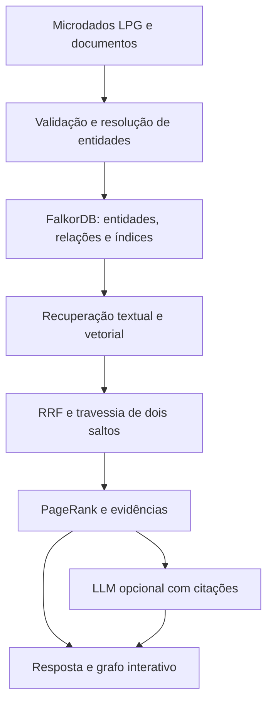

# Arquitetura e modelo de conhecimento

## Contexto

Domínio: análise rastreável de microdados do ensino superior, ano 2024. A expressão “centro de microdados” se refere à organização lógica de dados, consulta e procedência, não à implementação de infraestrutura física de datacenter.

O banco escolhido é FalkorDB, conforme orientação do professor informada pelo grupo. Não há dependência de Neo4j. A interface é Streamlit e pode ser editada no VS Code. Docker Compose inicia o banco e a interface.



## Entidades e relações

Os rótulos originais do repositório são preservados. Todos os nós também recebem `Entity`, `id`, `kind`, `name`, `name_norm`, `source_file`. Códigos como `CO_IES` permanecem strings. Indicadores `QT_*` são inteiros; flags `IN_*` são booleanos; vazios não são materializados como propriedades.

| Origem | Relação | Destino | Uso |
|---|---|---|---|
| OfertaCurso | OFERTA_DE | Curso | Identidade acadêmica |
| OfertaCurso | OFERTADA_POR | IES | Instituição responsável |
| OfertaCurso | LOCALIZADA_EM | Municipio | Localização da oferta |
| Municipio | PERTENCE_A_UF | UF | Geografia |
| UF | PERTENCE_A_REGIAO | Regiao | Geografia |
| Curso | OFERTADO_POR | IES | Instituição do curso |
| IES | SEDIADA_EM | Municipio | Sede, distinta do local da oferta |
| Curso | CLASSIFICADO_EM | CineRotulo | Classificação CINE |
| CineRotulo | PERTENCE_A_AREA_DETALHADA | CineAreaDetalhada | Hierarquia CINE |
| Documento | CONTEM | Trecho | Procedência documental |
| Trecho | MENCIONA | Entity | Relação extraída de texto |

Outros rótulos/relações de classificação, rede e mantenedora também são importados. O modelo original completo está em `lpg/schema/modelo.md` após baixar o repositório.

## Identidade, integridade e reimportação

`id = 2024:<ID original LPG>` mantém identidades distintas entre instituições/cursos com o mesmo nome. `MERGE` por ID torna a reimportação idempotente. As relações usam origem, tipo e destino. Não se fundem cursos apenas pelo nome.

Há índice exato em `Entity.id` antes da constraint UNIQUE, além de MANDATORY no mesmo campo. As constraints são consultadas até ficarem OPERATIONAL; falhas impedem concluir a importação. O fingerprint SHA-256 de todos os CSVs e caminhos ordenados impede importar outra versão no mesmo grafo. O status `importando` bloqueia perguntas durante uma carga interrompida.

`Metadata` guarda escopo, ano, fingerprint e identidade do modelo. O protótipo suporta um conjunto de 2024 por grafo. Novos escopos/modelos exigem outro nome de grafo.

## Índices FalkorDB

```cypher
CREATE INDEX FOR (n:Entity) ON (n.id)
CREATE INDEX FOR (n:Entity) ON (n.name_norm)
CALL db.idx.fulltext.createNodeIndex('Entity','search_text')
CREATE VECTOR INDEX FOR (n:Entity) ON (n.embedding)
OPTIONS {dimension:384, similarityFunction:'cosine'}
```

Unicidade e obrigatoriedade são criadas pelo protocolo Redis:

```text
GRAPH.CONSTRAINT CREATE nome_do_grafo UNIQUE NODE Entity PROPERTIES 1 id
GRAPH.CONSTRAINT CREATE nome_do_grafo MANDATORY NODE Entity PROPERTIES 1 id
```

O código usa parâmetros para valores. Rótulos e tipos, que não podem ser parâmetros, passam por validação de identificador antes de compor a consulta.

## Recuperação híbrida

Os vetores das entidades usam nome, sigla quando disponível e tipo; o full-text preserva um texto mais amplo com geografia e classificações. A geografia do contexto é recuperada por relações, para evitar que muitos nomes compartilhados dominem os vetores.

1. Normalizar a pergunta e obter até 20 termos sem operadores de busca externos.
2. Recuperar até 12 entidades pela busca full-text e até 12 pelo índice vetorial. No FalkorDB, o score vetorial é distância: menor é melhor, portanto o resultado usa ORDER BY score ASC.
3. Fundir rankings com RRF: `score(id) = Σ 1/(60 + posição)`; os escores brutos não são comparados diretamente.
4. Priorizar correspondências exatas de `name_norm` (resolução de entidade pela pergunta inteira) e completar até quatro sementes pelo RRF. Recuperar até 60 caminhos de comprimento 1–2 por semente. Os limites tornam a visualização manejável, mas reduzem completude.
5. Calcular PageRank apenas nesse subgrafo. Ordenar caminhos pelo somatório de PageRank de seus nós e usar a pontuação no tamanho visual.
6. Se houver filtros, executar agregação exata sobre todas as ofertas correspondentes e listar até 100. Acrescentar caminhos OfertaCurso → Curso → IES para contextualização.
7. Mostrar evidências, filtros, Cypher, parâmetros, fontes e IDs; gerar texto opcional por LLM.

Os indicadores não são calculados sobre o conjunto limitado de caminhos, e sim por consulta separada ao banco. Não se somam métricas diretamente em IES/Curso: o grão escolhido é `OfertaCurso`, conforme o LPG da fonte.

A confiança exibida é uma categoria de cobertura, sem probabilidade calibrada. Encontrar nós semanticamente próximos não significa que a pergunta possa ser respondida. No modo sem LLM, o retorno é uma relação de evidências e agregações explicitamente filtradas.

## Text-to-Graph

PDF textual/TXT → páginas → trechos de até 1.100 caracteres → normalização → reconhecimento por nomes/siglas existentes → resolução somente quando o alias tem um ID único → vínculos MENCIONA.

O conteúdo SHA-256 identifica o documento; página e índice identificam o trecho. Reimportações do mesmo conteúdo não duplicam trechos. Os textos e páginas são mantidos no banco e incluídos nas evidências documentais. O método não descobre livremente entidades novas e não infere relações factuais só por coocorrência.

## GraphRAG e KAG nesta implementação

GraphRAG: recuperação por texto/vetor enriquecida pela estrutura de relações e pelo subgrafo de contexto. KAG: esquema explícito, tipos, regras de identidade, filtros tipados, agregações determinísticas e evidências restringem o contexto da geração. É uma implementação acadêmica inspirada nesses princípios, não uma reprodução integral de um framework KAG externo.

O LLM pode transformar a pergunta em JSON de filtros validado; o código gera a consulta parametrizada a partir de um template fixo. Essa escolha diverge da geração livre de Cypher para reduzir consultas inválidas e mutações. Só leitura é usada no caminho de perguntas.

## Limitações de validação

O modelo semântico local foi testado com a amostra; os testes de integração usam hashing para repetibilidade. Sem chave/provedor de LLM, não se afirma validação de geração livre. A base nacional completa e o ambiente Docker Desktop do usuário precisam de validação no computador de apresentação. Detalhes em VALIDACAO.md.
